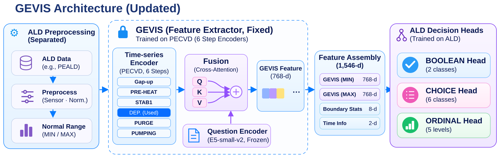
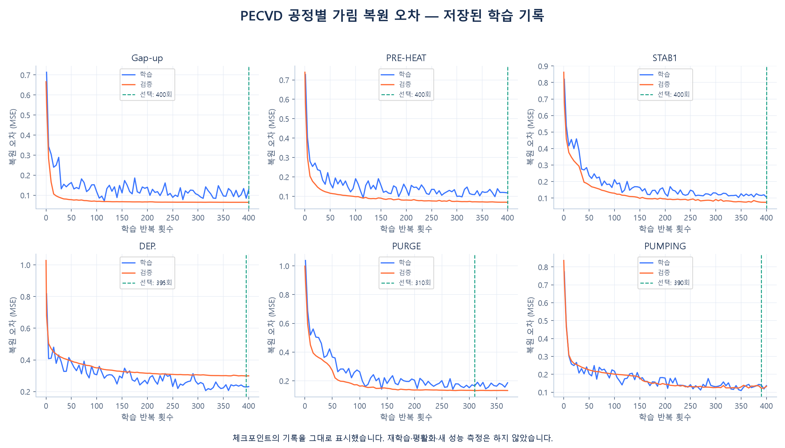
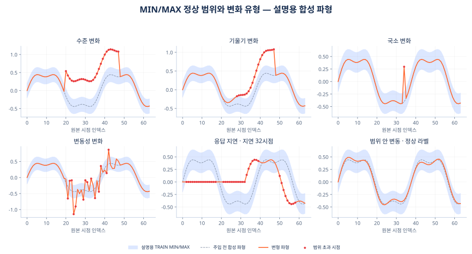

# GEVIS — 다중모달 융합 인코더

GEVIS는 시계열의 현재·참조 파형과 질문을 결합하는 특징 추출기입니다.
**시계열 인코더 → 비교 특징 → 질문 조건 교차 어텐션 융합**이 핵심이며,
BOOLEAN·CHOICE·ORDINAL 판별 헤드는 선택적인 후속 FDC 과제의 예제입니다.



인코더·Fusion·판별 헤드의 학습·로딩은 [notebooks/training/](notebooks/training/README.md),
ALD/CVD 실험과 평가는 [notebooks/](notebooks/README.md)를 사용합니다.

사용자가 제공한 구성의 SVG 재현입니다. 그림의 CHOICE 6개는 정상 인덱스를 포함한 저장 출력 수이며,
양성 변화 유형 비교는 5개입니다. ORDINAL 5개도 정상 인덱스를 포함한 저장 출력 수이고 양성 강도는
4단계입니다. `DEP. (Used)`는 ALD에 재사용하는 CVD 인코더를 표시합니다.

## 설치와 최소 실행

Python 3.10 이상을 사용합니다. CUDA 환경은 해당 장치에 맞는 PyTorch를 먼저 설치합니다.

```bash
python -m pip install -e '.[test]'
python examples/synthetic_features.py
python -m pytest tests/portable -q
```

이 예제는 외부 데이터·가중치·인터넷 없이 **미학습 모델과 합성 입력**으로 동작합니다.
출력은 `[질문 수, 768]` 특징이며, 정상/이상 판정이나 기존 모델 성능을 의미하지 않습니다.
E5 질문 인코더를 사용할 때는 `python -m pip install -e '.[text]'`가 필요합니다.
학습 데이터·제조 가중치·Hugging Face 모델 파일은 배포본에 포함하지 않습니다.

## 노트북으로 시작하기

프로젝트 루트에서 다음을 실행하고 Jupyter에서 `Python (PECVD)` 커널을 선택합니다.

```bash
python -m pip install -e '.[fdc,notebook]'
python -m ipykernel install --user --name pecvd --display-name "Python (PECVD)"
```

기존 가중치를 재사용하려면 [필요 자산과 폴더 배치](docs/weights.md)에 따라
인코더·Fusion·헤드·데이터를 별도로 준비합니다. GitLab에서 코드만 받은 상태에는 가중치가 없습니다.
E5 오프라인 모델 준비 방법은 [노트북 실행 안내](notebooks/README.md)에 있습니다.

| 목적 | 실행 파일 | 기본 동작 |
|---|---|---|
| 공정별 시계열 인코더 | `notebooks/training/STEP_1_train_patchtst_encoder.ipynb` | 저장된 6개 인코더 재사용. 저장본이 없으면 학습 |
| 질문·시계열 Fusion | `notebooks/training/STEP_2_train_gevis_backbone.ipynb` | STEP 1과의 연결을 검증해 저장 Fusion 재사용. 저장본이 없으면 학습 |
| CVD/ALD 판별 헤드 | `notebooks/training/STEP_3_train_gevis_decision.ipynb` | `ACTION='load'`로 현재 evaluate 저장 헤드 로딩. `'train'`으로 바꿀 때 전처리·학습·평가 |
| 저장 헤드 추론 | `notebooks/training/STEP_3.1_run_gevis_inference.ipynb` | 헤드 로딩 및 인공 입력의 추론 연결 확인. 학습 없음 |
| GEVIS만 로딩 | `notebooks/training/GEVIS_load.ipynb` | 고정 인코더·Fusion 로딩. 다른 STEP 선행 실행 불필요 |
| CVD 실험 | `notebooks/CVD_evaluate.ipynb` | 기존 CVD 전처리·분할로 헤드 학습·평가 |
| ALD 실험 | `notebooks/ALD_evaluate.ipynb` | data_complete 전처리와 세 CHOICE 방식의 헤드 학습·평가 |

`notebooks/training/` 노트북은 첫 코드 셀의 `PROJECT_PATH`에서 프로젝트 경로를 지정합니다.
기본 `None`은 현재 프로젝트를 찾습니다. 한 번 직접 지정하면 로컬 설정에 저장되어 다음 STEP이
같은 경로를 사용합니다. 서로 다른 커널에서 실행해도 설정을 공유합니다.
현재 evaluate 노트북은 첫 셀의 `WORKSPACE_PATH`로 데이터·가중치 폴더를 지정합니다.
현재 저장소에 자산을 배치했다면 두 설정 모두 `None`으로 두면 됩니다.

저장본을 이용할 때 STEP 전체 재학습은 필요하지 않습니다. 단, evaluate의 학습 셀은
실험을 실행하는 셀이므로 저장본 추론만 필요하면 STEP 3의 `ACTION='load'`와 STEP 3.1을 사용합니다.
STEP 3과 3.1의 `DOMAIN`은 CVD에 `'PECVD'`, ALD에 `'PEALD'`로 맞춥니다.
같은 CHOICE 방식에 저장본이 여러 개면 `CHECKPOINTS`에 사용할 파일을 지정합니다.

## 사전학습 가중치로 특징 추출

```bash
python examples/extract_features.py --manifest /models/encoder/encoder_manifest.json --backbone /models/fusion/gevis_backbone.pt --data-path /inputs/pair.npz --step DEP. --center sensor_A --device cpu
```

`pair.npz`에는 TRAIN 정규화를 적용한 `current`, `reference` 배열 `[time,sensors]`와
동일 순서의 문자열 `sensor_names`가 필요합니다. 파일 경로는 Windows/Linux 절대·상대 경로를
지원합니다. `--text-model-path`로 E5 로컬 모델 디렉터리를 지정할 수 있습니다.
오프라인 환경에서는 모델 파일을 미리 준비하고 `HF_HUB_OFFLINE=1`을 설정합니다.

독립 로더는 기존 **원본 시점 다중 스케일 인코더와 v10 융합 가중치**를 지원합니다.
다른 과거 구현을 임의로 변환하거나 일부 가중치만 로드하지 않습니다.
인코더 목록과 파일의 체크섬, 목록과 융합 가중치의 연결, 상태 사전의 차원을 검사합니다.
경로 변경은 가중치 수정이나 재학습을 발생시키지 않습니다.

## 새 데이터로 학습

```bash
python examples/train_encoder.py --data-path /inputs/windows.npz --output /models/new_numeric_encoder.pt --epochs 40
```

NPZ의 `train`, `validation`은 `[windows,time,sensors]` 배열입니다. 사용자가 먼저 Run을
독립적으로 분할하고 TRAIN에서만 정규화를 적합해야 합니다. Test는 학습에 입력하지 않습니다.
기존 다중 스케일 가림 복원 자기지도 목적함수를 사용하지만, 이 간결한 새 데이터용 학습 루프가
과거 표본 추출·학습률 조절·전체 실험을 재현한다고 주장하지 않습니다. **이 명령은 숫자 인코더만
학습하며 융합은 학습하지 않습니다.** 저장 파일은 별도 `gevis.numeric_ssl.portable.v1` 형식입니다.

기존 전체 숫자 인코더·융합 학습 과정은 선택 배포본에서 Python 프로그램으로 보존했습니다.
Jupyter 없이 실행할 수 있으며, 기존 데이터·설정·재사용/덮어쓰기 보호 규칙을 사용합니다.

```bash
python examples/train_historical.py --component encoder --root /workspace
python examples/train_historical.py --component fusion --root /workspace
```

## CVD / ALD FDC 예제 (선택 배포)

노트북으로 실행한다면 FDC 배포본의 `notebooks/README.md`와
[작업 폴더 구성](docs/weights.md)을 먼저 확인하세요. 첫 셀의 `WORKSPACE_PATH`로
코드 저장소와 데이터·가중치 위치를 분리할 수 있습니다.

`src/heads/`는 핵심 모델과 분리되어 있으며 `GEVIS_Model`이 가져오지 않습니다.
기존 헤드의 소스 해시 호환성을 위해 `src/pecvd`의 보수적인 의존성 집합을 별도로 유지합니다.
FDC 예제는 `--with-fdc`로 만든 소스 배포본과 `pip install -e '.[fdc]'`가 필요합니다.
기존 가중치·설정·CVD 입력 구간 캐시는 별도로 준비해야 합니다.

```bash
python examples/run_peald.py --root /workspace --action train
python examples/run_pecvd.py --root /workspace --action train
```

명령을 명시적으로 실행할 때만 헤드를 학습합니다. 인코더와 융합은 고정합니다.
외부 데이터 경로는 기존 전처리를 바꾸지 않는 별도 작업 폴더로 연결합니다.

```bash
python examples/run_peald.py --root /workspace --action train --data-path /datasets/data_complete --workspace /new-experiment
```

동일 드라이브에서는 수정하지 않을 입력·가중치를 하드 링크로 연결합니다. 다른 드라이브에서 실패하면
`--copy-assets`를 명시해 복사할 수 있습니다. 원본 입력과 연결된 자산을 직접 수정하지 마세요.
새 헤드·캐시는 새 작업 폴더에 생성됩니다. CVD는 원래 CSV의 체크섬과 저장된 입력 구간·Run 분할이
일치해야 하므로 임의의 새 CSV를 경로만 바꿔 넣을 수 없습니다.

기존 헤드 추론은 `--action predict --checkpoint ... --window ... --metadata ...`로 실행합니다.
NPZ에는 `current`, `sensor_columns`, JSON에는 `step`, `recipe_key`, `loop_key`,
`offset_samples`, 독립적인 `lineage_id`가 필요합니다. 기본 입력은 원시 센서 값이며,
이미 정규화했다면 `--standardized`를 지정합니다. `--allow-legacy-cvd`는 명시적 호환 로딩이며,
과거 결과와의 완전한 동일성을 보증하지 않습니다.
기존 ALD 저장본에서 공용 헤드 모듈 해시만 달라졌다면 `--allow-legacy-ald`를 명시할 수
있습니다. ALD 전처리/입력 저장 코드 차이는 이 옵션으로 허용하지 않습니다.

ALD 입력은 `data_complete`만 사용합니다. 전달용 Test·merge_peald·외부 process.json은 사용하지
않습니다. **기존 CVD로 학습한 DEP 인코더를 모든 지원 ALD 공정 경로에 재사용**합니다.
DEP만 ALD 입력으로 선택한다는 뜻이 아니며, DEP가 최적이라는 비교 검증도 별도입니다.

## 실제 PECVD 인코더 학습 기록



6개 공정 체크포인트의 학습·검증 복원 오차와 실제 가중치 선택 시점입니다.
재학습하거나 예시 수치를 넣지 않았습니다. 학습 목적함수, DEP 상세 그래프, Test 집계와
해석 조건은 [실제 학습 기록](docs/training/README.md)에 있습니다.

## 이상 주입과 평가



TRAIN MIN/MAX 참조 범위와 합성 변화는 설비 고장 정답이 아닙니다.
현재 과제는 **정상 참조 기반 시계열 변화 탐지이며, 합성 이상을 이용한 지도학습**입니다.
고정 GEVIS 특징으로 변화 여부·유형·강도를 예측합니다. 합성 이상은 학습·평가 정답 생성 방식입니다.
정상 원본이라는 데이터셋 전제 아래 연속 센서에 수준·변동성·기울기·국소 변화·지연을 생성합니다.
Softmax / Grouped Softmax / 독립 Sigmoid를 비교하되, 여러 Sigmoid 점수가 높다고 복합 고장이
입증되는 것은 아닙니다. [전처리와 라벨](docs/preprocessing.md),
[판별 및 성능 해석](docs/evaluation.md)을 참고하세요.

실험 수치는 체크포인트·Run 분할·센서 수·평가 조건과 묶어 기록합니다. 현재 리팩터링의
검증 범위와 미검증 항목은 [검증 기록](docs/verification.md)에 구분했습니다.

## 폴더 구성

```text
src/
  GEVIS_Model/          # 공개 라이브러리: 인코더·Fusion·추론·학습
  heads/                # CVD/ALD 응용 및 기존 학습 프로그램
  pecvd/                # 저장 가중치와 호환되는 내부 구현
notebooks/
  training/             # STEP 1·2·3·3.1, GEVIS 로딩, 공통 경로 설정
  ALD_evaluate.ipynb     # ALD 전처리·헤드 학습·평가
  CVD_evaluate.ipynb     # CVD 헤드 학습·평가
config/                 # 공정·실험 설정과 examples/ 경로 예시
examples/               # Python으로 실행하는 짧은 사용 예제
docs/                   # 구조·가중치 준비·전처리·평가·변경 이력
scripts/                # 검증·소스 배포·문서 그림 생성
tests/                  # 라이브러리 및 전처리 회귀 테스트
```

## GitLab 배포

```bash
python scripts/build_gitlab_source.py --output /new-path/gevis-core
python scripts/build_gitlab_source.py --output /new-path/gevis-fdc --with-fdc
```

첫 명령은 독립 인코더만, 두 번째는 CVD/ALD 예제까지 포함합니다. 목적지는 새 디렉터리여야 합니다.
실제 데이터·가중치·캐시·Git 이력·개인 설정은 복사하지 않고 평가 노트북 출력도 제거합니다.
FDC 배포본에는 `notebooks/training/`의 실행용 노트북과 공통 경로 모듈도 포함합니다.
로컬 복구 자료·원본 보관 사본·개인 경로 설정은 포함하지 않습니다.
**현재 작업 폴더에서 `git add .`로 전체를 올리지 말고 생성한 소스 배포본을 검토하세요.**
기존 Git 이력은 검사·정제되지 않았습니다. 코드/제조 가중치의 재배포 라이선스는 소유자가 결정해야
하며, 이 저장소가 임의의 오픈소스 사용 권한을 부여하지는 않습니다.

실제 삭제 결과와 남겨 둔 호환 코드의 이유는 [정리 기록](docs/refactoring.md)에 있습니다.

과거 시행착오와 수정 이유는 [docs/failure_log.md](docs/failure_log.md)에 통합했습니다.

Python 패키지는 표준 `src` 구조로 설치합니다. 사용자는 `GEVIS_Model` API를 사용하며,
`pecvd`는 기존 가중치의 소스 검증을 유지하는 내부 호환 구현입니다.
폴더 이동으로 재학습하거나 저장 가중치를 변환할 필요는 없습니다.
