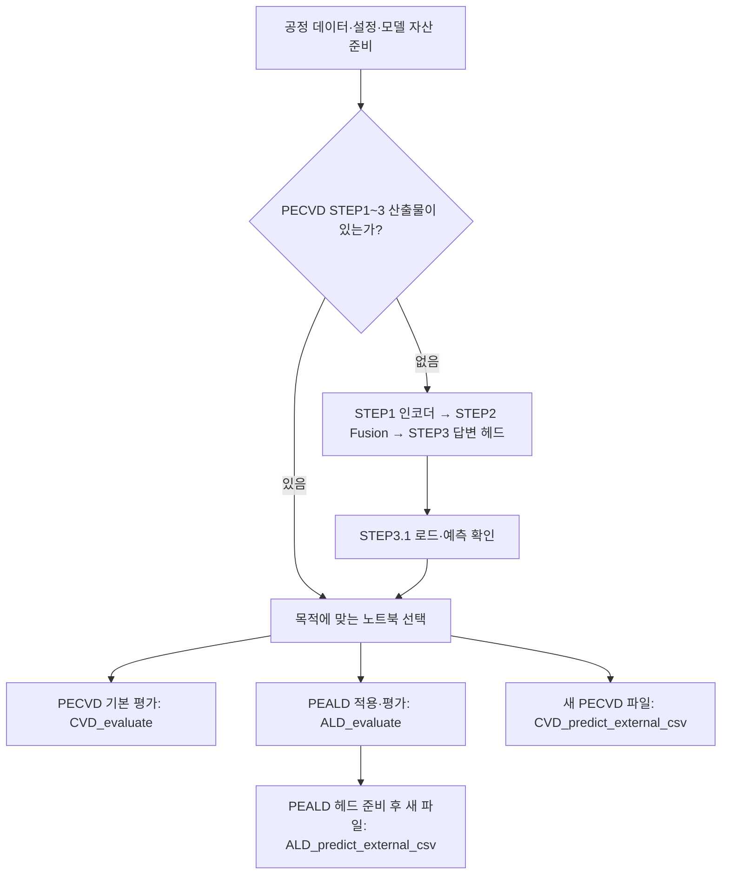
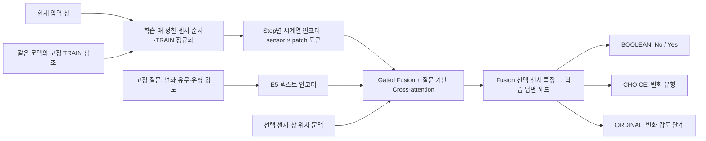

<!-- gevis-contract-sha256: abfc5e15f906a608bc94387c62a5771211ee86adb74ca1761de1c08e94351d11 -->
<!-- peald-encoder-routing: peald_native_validation_encoder_routes_v1 -->

# GEVIS — PECVD·PEALD 시계열 판독 모델

TIPS의 고정 Parquet 분할로 학습·평가하려면 [TIPS PEALD 실행 안내](_docs/tips-peald-training.md)와 [전용 노트북](notebooks/TIPS_PEALD_train_evaluate.ipynb)을 사용합니다. STEP 1 인코더 6개와 STEP 2 전체 가중치를 고정하고, 특징을 한 번 저장한 뒤 TIPS 답변 헤드만 학습합니다. 현재 보관된 legacy 소스와 TIPS 센서의 연결에는 명시적인 입력 어댑터를 사용합니다.

GEVIS는 **현재 센서 파형과 참조 파형을 읽고, 선택한 센서의 변화 유무·유형·강도를 반환**합니다. 시계열 인코더, 질문을 반영하는 Fusion/Cross-attention, 학습된 답변 헤드로 구성합니다. 현재 학습 정답은 통제한 합성 변화이며, 실제 공정 정상/이상 탐지는 향후 별도 라벨 학습·검증 대상입니다.

**처음 받은 팀원은 데이터·설정·학습 가중치를 먼저 준비해야 합니다. 이 Git 저장소에는 소스와 출력 없는 노트북만 있으며 공정 CSV·학습 가중치·기밀 결과는 포함하지 않습니다.**

## 1. 내 상황에서 무엇부터 실행하나

| 상황 | 준비물 | 실행 순서 |
| --- | --- | --- |
| 기존 PECVD 모델의 성능·속도를 확인 | 일치하는 PECVD 설정·STEP1~3 학습 산출물·캐시 | **CVD_evaluate**. STEP1~3 재학습 불필요 |
| PECVD 학습 산출물이 없음 | 학습용 분석 CSV·설정·공개 모델 자산·STEP2 초기화 조건 | **STEP1 → STEP2 → STEP3 → STEP3.1 → CVD_evaluate** |
| PEALD를 처음 적용 | PECVD 모델 + PEALD 원시 CSV·매핑 | **PEALD 매핑 준비 → ALD_evaluate에서 헤드 학습 허용 → 평가** |
| 기존 PEALD 모델을 다시 평가 | 기존 PEALD 데이터·매핑·헤드와 PECVD source 모델 | **ALD_evaluate**, `RUN_PEALD_TRAINING=False` 유지 |
| 새 PECVD CSV의 답변·시간 확인 | 기존 PECVD 모델·TRAIN 참조 캐시 + 새 CSV | **CVD_predict_external_csv** |
| 새 PEALD CSV의 답변·시간 확인 | 기존 PECVD/PEALD 모델·원본 PEALD 준비 데이터·매핑 + 새 CSV | **ALD_predict_external_csv** |

아래 파일명은 모두 `notebooks/` 기준입니다. **CVD_는 PECVD, ALD_는 PEALD**입니다. `CVD_evaluate`가 이전 STEP4이고, `ALD_evaluate`가 이전 EXP6입니다. 연구 노트북 3개는 기본 평가·외부 예측의 필수 선행 단계가 아닙니다.



## 2. GEVIS는 어떻게 판단하나



- **STEP1 인코더:** 시계열을 patch로 나눠 복원·표현 학습합니다. 현재 기본 설정은 `model_variant=multiscale`입니다.
- **STEP2 Fusion:** 현재/참조 토큰과 질문 표현을 결합합니다. 초기에 수치 max pooling·텍스트 mean pooling을 결합하던 구조에서 질문 기반 Cross-attention 방향으로 발전했습니다.
- **STEP3 답변 헤드:** 인코더·Fusion을 고정하고 합성 변화 정답으로 세 답변을 학습합니다. TRAIN으로 학습하고 Validation에서 선택합니다.
- **추론:** 입력마다 Attention 표현을 계산하고 학습 헤드의 logits/softmax/argmax로 답합니다. 정답을 입력해야 예측할 수 있는 구조가 아닙니다. 맞았는지 채점할 때만 별도 정답이 필요합니다.

| 답변 | 의미 | 현재 선택지 |
| --- | --- | --- |
| BOOLEAN | 선택 센서의 변화 유무 | No / Yes |
| CHOICE | 변화 형태 | No clear change / Mean level / Variability / Trend slope / Local change / Delay |
| ORDINAL | 합성 변화의 강도 단계 | No change / Small / Moderate / Large / Very large |

현재 ORDINAL은 물리적 고장 심각도와 같지 않습니다. Attention은 고장 원인이나 정답이 아니며 softmax는 검증된 고장 확률이 아닙니다. 통계 threshold 조정으로 최종 답을 결정하는 방식은 폐기했고, 모델·호환 참조가 없으면 임의 답변을 만들지 않습니다.

**PECVD와 PEALD의 차이:** PECVD는 Step별 인코더·공통 Fusion을 사용합니다. PEALD 기본은 **PECVD `DEP.` 인코더·Fusion을 동결해 재사용하고 별도 PEALD 공통/채택된 Step 헤드를 학습**합니다. PEALD Step마다 PECVD source를 자동 교체하는 설정은 현재 기본이 아닙니다.

## 3. 먼저 준비할 파일

### PECVD 학습·기본 평가

| 준비물 | 위치·설정 | 확인할 것 |
| --- | --- | --- |
| 분석용 시계열 CSV | `config/processes/pecvd.json`의 `data_path` | raw 파일 목록·manifest가 아니라 센서 측정 행이 있는 분석 테이블 |
| 열·Step 정의 | 같은 JSON의 `columns`, `steps` | 회차·Step·행 순서 열, window/patch/stride와 실제 데이터 일치 |
| 모델 실행 프로필 | `config/experiments/gevis_pipeline.json` | 현재 `decision_system=fusion_answers`, `model_variant=multiscale` |
| STEP1 산출물 | `artifacts/`의 해당 encoder namespace | Step 체크포인트·manifest·학습 정규화·분할·window 캐시를 함께 준비 |
| STEP2·3 산출물 | `artifacts/`의 해당 backbone/readout namespace | backbone과 `fusion_answers_…` 헤드의 source·모델 identity 일치 |
| 공개 모델 자산 | 로컬 Hugging Face 캐시 및 `.cache/pretrained_patchtst/` | E5와 해당 encoder backend가 요구하는 공개 자산 |

기본 PECVD 열 설정은 `process_key`(회차), `step_label`(Step), `row_in_process`(회차 내 순서)입니다. Step one-hot을 사용하는 경로도 있습니다. 원본을 다른 열 이름으로 준비했다면 설정과 전처리 규약을 함께 맞춰야 합니다. 식별자·메타데이터를 측정 센서로 학습시키지 않습니다.

GitLab 전달본의 `data_path`는 `data/LOCAL_APPROVED_ANALYSIS.csv`라는 자리표시자입니다. **승인된 실제 로컬 경로로 바꿔야 합니다.** 기존 모델을 재사용할 때는 담당자가 제공한 원래 설정·데이터·가중치 묶음을 함께 복원해야 하며 파일명만 맞춘다고 호환되는 것은 아닙니다. 가중치 폴더를 임의로 바꾸거나 identity 검사를 해제하지 않습니다.

raw PECVD를 분석 테이블로 만드는 보조 도구는 [build_analysis_table.py](scripts/build_analysis_table.py)입니다. 원본 열과 공정 시작 시각 정의를 확인한 뒤 사용합니다. 모든 raw CSV에 동일하게 적용되는 자동 변환기로 가정하지 않습니다.

### PEALD 적용·기본 평가

PEALD는 위 PECVD source 모델에 더해 다음 파일이 필요합니다.

- 승인된 **PEALD 원시 시계열 CSV**. 기본 준비 스크립트의 입력 예시는 `data/merge_peald.csv`입니다.
- 로컬 매핑 **`.cache/external/peald/process.json`**. 원시 회차·Step·시간·recipe 문맥·센서 열을 연결합니다.
- 학습을 마친 **PEALD 답변 헤드**. 처음 적용하면 ALD_evaluate에서 별도로 학습합니다.

지원 장비 메타데이터 형식에 맞는 경우 프로젝트 루트에서 다음 명령으로 매핑을 준비합니다.

```powershell
python scripts/configure_external_process.py --source data/merge_peald.csv --auto-peald
```

이 preset은 `ActivePjobID`, `PPExecStepName`, `Timestamp`, `PMStoredProcessRecipeName`, `PPExecname` 열을 요구합니다. TRAIN의 관측률·변동과 이름 규칙으로 센서를 고르므로 모든 원시 센서가 자동 채택되는 것은 아닙니다. 생성된 매핑과 지원/제외 사유를 검토합니다. 기존 매핑이 있으면 자동 덮어쓰지 않습니다.

다른 장비 형식은 `source_columns`를 포함한 원시 입력 매핑을 별도로 준비해야 합니다. 일반 `ald.template.json`의 자리표시자만 바꾼 것으로 현재 PEALD 전이 입력 규약을 충족한다고 가정하지 않습니다. **DEP 전이 실험을 할 때 `GEVIS_PROCESS_CONFIG`를 PEALD로 바꾸지 않습니다.** PECVD source 설정은 유지하고 ALD_evaluate가 PEALD 매핑을 별도로 읽습니다.

## 4. 환경 준비와 Jupyter 실행

명령은 저장소 루트에서 실행합니다. 예시는 Windows PowerShell·Python 3.12 기준입니다. 기존에 쓰던 PECVD 환경이 있다면 그 환경을 Jupyter 커널로 선택할 수 있습니다.

```powershell
python -m venv .venv
.\.venv\Scripts\Activate.ps1

# 저장소에 명시된 NVIDIA CUDA 13.0 프로필
python -m pip install torch==2.10.0 --index-url https://download.pytorch.org/whl/cu130
python -m pip install -r config/requirements-a.txt
python -m pip install matplotlib jupyterlab ipykernel

python -m ipykernel install --user --name gevis --display-name "Python (GEVIS)"
$env:PYTHONPATH = "src"
python scripts/setup_patchtst.py
python -m jupyterlab
```

`requirements-a.txt`는 CUDA 빌드가 고정된 프로필입니다. CPU·다른 CUDA 환경에 그대로 설치하는 범용 명령이 아니며 해당 장비에 맞는 PyTorch 프로필을 따로 맞춰야 합니다. 추가 설치한 Jupyter 계열 패키지 버전도 재현 실험에서는 기록합니다. 선택 연구용 `requirements-experiments.txt`는 기본 추론의 필수 설치 목록이 아닙니다.

`setup_patchtst.py`는 공개 가중치만 다운로드합니다. E5(`intfloat/e5-small-v2`) 자산도 준비돼 있어야 합니다. STEP2의 최초 공개 모델 로드에는 네트워크가 필요할 수 있고, ALD·외부 CSV 노트북은 offline 모드이므로 실행 전에 캐시를 준비합니다. 공개 자산 준비와 별개로 **팀에서 학습한 GEVIS 가중치는 GitLab에서 자동 다운로드되지 않습니다.**

Jupyter에서 `Python (GEVIS)` 또는 실제 의존성을 설치한 커널을 고르고, 각 노트북을 **첫 셀부터 순서대로 Run All** 합니다. STEP 노트북의 작업 디렉터리는 프로젝트 루트 또는 `notebooks/`로 둡니다. 파일마다 별도 커널로 실행해 앞 노트북의 변수를 수동 전달하지 않습니다. 동시에 학습·평가를 돌리면 자원 경합으로 시간이 달라질 수 있으므로 속도 비교 때는 순차 실행합니다.

## 5. PECVD — STEP부터 기본 평가까지

| 순서 | 파일 | 하는 일·완료 시 확인 |
| --- | --- | --- |
| 1 | [STEP1](notebooks/STEP_1_train_patchtst_encoder.ipynb) | 회차 분리·TRAIN 정규화·Step별 인코더 복원 학습. 체크포인트·encoder manifest·window 캐시 준비 |
| 2 | [STEP2](notebooks/STEP_2_train_gevis_backbone.ipynb) | STEP1 표현과 질문의 Fusion/Cross-attention 학습. 현재 프로필의 backbone 체크포인트 준비 |
| 3 | [STEP3](notebooks/STEP_3_train_gevis_decision.ipynb) | 고정 STEP1/2 위에 세 답변 헤드 학습. Validation 결과와 `fusion_answers_…` 체크포인트 확인 |
| 3.1 | [STEP3.1](notebooks/STEP_3.1_run_gevis_inference.ipynb) | 기존 모델을 로드해 선택 문맥의 답변 반환 확인. 학습 단계가 아님 |
| 4 | [CVD_evaluate](notebooks/CVD_evaluate.ipynb) | 기존 STEP4. 합성 Test 성능과 원본 Test 창의 요청 지연을 각각 출력 |

**STEP2의 중요한 기본 조건:** `reuse_text_checkpoint=True`여서 기존 E5 텍스트 학습 체크포인트를 재사용합니다. source 묶음을 받았다면 `TEXT_REUSE_PATH`와 출력된 선택 경로를 확인합니다. 현재 backbone이 없고 초기 텍스트 체크포인트도 없다면 기본 Run All은 중단됩니다. 완전히 처음 학습하는 실험은 `Config`의 `reuse_text_checkpoint=False`로 텍스트 학습부터 시작하는 별도 조건으로 실행·기록해야 합니다. 기존 모델과 같은 실험 결과로 취급하지 않습니다.

STEP1은 일치하는 저장 manifest가 있으면 재사용하는 경로가 있습니다. STEP2도 일치하는 저장 backbone을 재사용합니다. STEP3의 `RUN_TRAINING=False`는 STEP1/2를 다시 학습하지 않는다는 뜻이며, 현행 답변 헤드는 `RUN_FUSION_ANSWER_TRAINING` 경로에서 준비됩니다. 해당 설정을 보고 STEP3 전체가 학습하지 않는다고 해석하지 않습니다.

모델이 준비됐다면 readiness를 확인합니다.

```powershell
$env:PYTHONPATH = "src"
python -B scripts/check_gevis_docs.py
python scripts/check_gevis_pipeline.py
```

새 clone에서 가중치가 없으면 `MISSING`은 예상된 준비 상태입니다. STEP1/2가 없으면 그 단계부터, STEP3 헤드만 없으면 STEP3부터 준비합니다. source identity 불일치는 해당 학습 묶음·설정을 확인해야 하는 상태이며 파일 삭제·덮어쓰기·검사 해제로 해결하지 않습니다.

## 6. PEALD — 적용 학습과 평가

1. PECVD STEP1~3 모델을 먼저 준비합니다. PEALD에서도 이 source 모델을 로드합니다.
2. 3절의 PEALD CSV·매핑을 준비합니다.
3. [ALD_evaluate](notebooks/ALD_evaluate.ipynb)를 열고 아래 설정을 확인합니다.

```python
ENCODER_SELECTION_MODE = 'single'
SOURCE_ENCODER_STEP = 'DEP.'
RUN_PEALD_TRAINING = False
```

4. **PEALD 헤드를 처음 만들 때만** `RUN_PEALD_TRAINING=True`로 바꾸고 첫 셀부터 실행합니다. TRAIN으로 공통/Step 후보 헤드를 학습하고 Validation에서 선택합니다. PECVD 인코더·Fusion 가중치는 갱신하지 않습니다.
5. 기존 헤드가 준비된 다음 평가부터는 `False`로 두고 재사용합니다. `False`에서 헤드가 없거나 identity가 다르면 학습 대신 중단됩니다.
6. 결과에서 **합성 paired Test 성능표**와 **원본 PEALD 창의 TRAIN 참조 요청 지연표**를 각각 확인합니다.

기본 `ENCODER_SELECTION_MODE='single'`을 유지합니다. `'validation'`은 여러 PECVD source 인코더를 후보별 새 헤드로 비교하는 별도 연구이며 기존 DEP 모델보다 좋은 것으로 채택된 기본값이 아닙니다.

## 7. 새 CSV를 입력해 답변과 속도 확인

| 공정 | 파일 | 기본 입력 폴더 | 요구하는 입력 |
| --- | --- | --- | --- |
| PECVD | [CVD_predict_external_csv](notebooks/CVD_predict_external_csv.ipynb) | `data/injected_pecvd/` | 학습과 같은 PECVD 분석 형식. 회차·Step·순서·모델의 센서 열 및 문맥 메타데이터 |
| PEALD | [ALD_predict_external_csv](notebooks/ALD_predict_external_csv.ipynb) | `data/injected_data/` | PEALD 매핑에 맞는 원시 형식. 원래 metadata와 지원 센서 열 유지 |

두 공정의 CSV 형식은 다릅니다. 원시 PECVD 파일을 분석 형식처럼 넣거나 PEALD 파일을 CVD 노트북에 넣지 않습니다. 모르는 센서를 자동 연결하거나 빠진 문맥을 임의 생성하지 않습니다. ALD 경로는 기존 PEALD 학습 헤드를 로드하며 원본 PEALD 준비 데이터·매핑도 필요합니다.

1. 공정에 맞는 폴더에 승인된 새 CSV를 둡니다. 다른 경로면 setup 셀의 `INPUT_DIRECTORY`를 바꿉니다. 파일은 해당 폴더 바로 아래 `*.csv`를 읽습니다.
2. 기존 모델·정규화·TRAIN 참조를 유지한 채 위에서 아래로 실행합니다. 새 파일로 재학습하거나 정규화를 다시 맞추지 않습니다.
3. 첫 확인은 아래 기본 범위를 사용합니다.

```python
MAX_FILES = 1
MAX_WINDOWS_PER_FILE = 8
SELECTED_STEPS = None
SELECTED_SENSORS = None
WINDOW_STRIDE = None
SHOW_DETAILS = False
```

4. 필요한 경우 `MAX_FILES=None`, `MAX_WINDOWS_PER_FILE=None`으로 **둘 다** 바꿔 전체 파일·완전한 창을 처리합니다. `SELECTED_SENSORS=None`은 모든 지원 센서를 뜻하며 원시 CSV의 모든 열이 지원된다는 의미는 아닙니다.
5. 화면의 답변 미리보기·요청 지연·coverage를 확인합니다. 전체 예측은 `PREDICTIONS` 또는 `REPORT.details`에 있습니다. coverage는 준비 가능한 창, 처리한 창, 상한 때문에 요청하지 않은 창을 구분합니다.

`WINDOW_STRIDE=None`은 겹치지 않는 완전한 native 창을 처리하는 기본값입니다. 원본과 비교해 채점한다는 뜻이 아닙니다. 현재 두 노트북은 **예측·시간만 출력하며 주입·원본 정렬·정답 채점·재학습을 수행하지 않습니다.** CSV 순차 재생은 실제 장비의 도착 간격·대기열을 재현하는 스트리밍 시험과도 다릅니다.

예측만 할 때 정답은 필요 없습니다. 추후 정확도까지 검증하려면 학습·선택에 쓰지 않은 회차의 미주입 대조본·변형본과 별도 주입 센서·구간·유형·강도 정답을 함께 준비합니다. 현재 외부 CSV 시험은 새 데이터 준비 후 재개하는 상태입니다.

## 8. 성능과 속도는 어느 출력에서 보나

| 알고 싶은 것 | 실행·출력 | 해석 |
| --- | --- | --- |
| PECVD 세 답변 정확도·F1 | CVD_evaluate의 합성 Test 표 | 내부 생성기가 만든 변화 정답 기준 |
| PEALD 세 답변 정확도·F1 | ALD_evaluate의 paired Test 표 | PEALD 원본 창에 합성 변화를 만든 정답 기준 |
| 기존 데이터의 요청 속도 | 각 evaluate의 timing 표 | 원본 Test 창 + TRAIN 참조의 전체 센서·세 답변 요청 |
| 새 파일의 답변·요청 속도 | 공정별 predict_external_csv | 무라벨 예측·실제 처리 범위·지연. 정확도 미채점 |

Fast 목표는 **전체 선택 센서의 세 답변 요청 평균≤50ms, F1≥0.96**입니다. BOOLEAN 양성 F1, CHOICE/ORDINAL macro F1을 나눠 보고 변화 사례 정확도·강도 오차도 봅니다. 최종 답변별 수락 조건은 별도 확정합니다. CHOICE·ORDINAL도 Fast 출력이며 미래 연속값 예측인 Precision으로 넘긴다는 뜻이 아닙니다.

`request_ms`/요청 요약의 `mean_ms` 또는 `mean_ms_per_window`가 창 요청 시간입니다. 참조 선택·정규화·인코더·Fusion·헤드·결과 구성을 포함하고 파일 읽기·모델 로드·창 준비·수집·큐·전송은 제외합니다. `Test evaluation elapsed`는 사례 생성·채점까지 포함한 전체 평가 시간으로 요청 지연과 다릅니다. ms를 초로 바꾸려면1000으로 나눕니다. 50ms는0.05초입니다.

평가 노트북 기본 `BENCHMARK_REPEATS=3`, `BENCHMARK_WARMUP=1`은 빠른 확인용입니다. 인수·성능 비교에는 같은 창·센서 수·모델·장비·seed·워밍업·반복 조건을 고정하고 반복 수를 정해 평균·p95/p99·변동을 함께 봅니다. 소수 요청의 p99를 안정된 운영 지표로 취급하지 않습니다. seed는 시간 변동을 없애는 설정이 아닙니다.

현재 수치 요약은 로컬 `_evidence/local/README.md`, 상세 원표는 같은 폴더의 개발 결과 문서에 있습니다. **GitLab에는 기밀 결과 MD가 포함되지 않으므로** 승인된 결과는 팀 내부 경로로 별도 열람합니다. 합성 점수는 실제 고장 성능이 아니며 과거 Test를 참고한 개발 이력도 최종 미열람 holdout과 구분합니다.

## 9. 선택 연구는 언제 돌리나

| 파일 | 바꾸는 것 | 학습 여부 | 목적 |
| --- | --- | --- | --- |
| [질문 민감도](notebooks/research/CVD_question_sensitivity.ipynb) | 같은 파형에서 질문 입력 | 기존 모델 고정 | 질문이 답변에 미치는 영향 |
| [합성 변화 일반화](notebooks/research/CVD_synthetic_change_generalization.ipynb) | Test 파형의 변화 크기·위치·방향·복합 조건 | 기존 모델 고정 | 다른 합성 변화 조건의 판독 |
| [특징 기여](notebooks/research/CVD_feature_ablation.ipynb) | 같은 예제에서 헤드에 전달할 특징 묶음 | 조건별 임시 헤드 재학습 | 판단에 도움이 되는 정보 조합 |

세 연구는 모두 CVD 내부 실험이며 외부 CSV 예측과 다릅니다. 특징 가림은 전체 계산 후 일부 정보를 가리는 방식이라 모델 구성요소 제거·속도 개선을 증명하지 않습니다. 자세한 조건은 [연구 안내](notebooks/research/README.md)를 봅니다.

## 10. 다음 실험과 문서

향후 우선순위는 **auto labeling으로 정답을 준비해 GEVIS 이상 탐지 학습·검증 → 깊은 추론이 필요한 사례의 추가 처리 설계 → seed와 입력·환경·측정 조건을 고정한 재현 비교**입니다. 아직 현행에 구현·검증 완료된 기능으로 보지 않습니다.

| 문서 | 내용 |
| --- | --- |
| [Blueprint](_blueprint/experiment-plan.md) | 현재 구현과 다음 실험·추가 보완 항목 |
| [상세 실험 안내](_blueprint/gevis-experiment-guide.md) | 변화 생성·drift·학습 경계·과거 이름·참고 논문/모델 |
| [노트북 안내](notebooks/README.md) | 공정별 실행 목록 |
| [코드 구조](_docs/README.md) | 모델·전처리·추론·평가 모듈 역할 |
| [개발 변경 기록](_docs/gevis-failure-lessons.md) | TCN·pooling·threshold 폐기 등 주요 설계 결정 |
| [검증·전달](_docs/verification.md) | 합성 회귀·readiness·소스 전달본 구성 |

웹 UI/API는 현재 제거돼 노트북이 기본 진입점입니다. 이 GitLab 전달본은 기밀 파일·기존 작업 Git 이력을 제외한 소스 저장소입니다. **기밀 이력이 남아 있는 원래 작업 저장소를 게시할 때만** [배포 빌더](scripts/build_gitlab_release.py)로 정제된 전달본을 구성합니다. 데이터·가중치·정답·실행 결과를 이 저장소에 추가해 push하지 않습니다.
