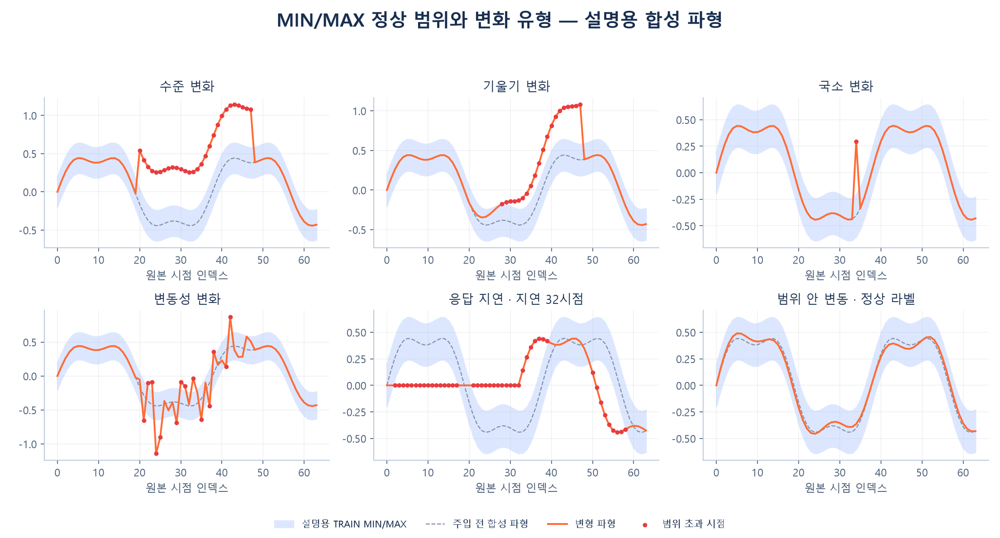
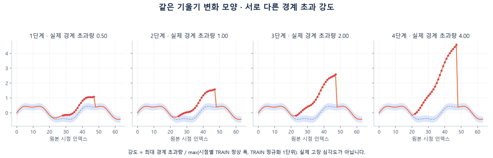

# 합성 변화 도식의 의미



원본 센서 데이터나 모델 예측이 아닌 설명용 합성 파형입니다. 실제 학습에서 사용하는
`controlled_variant`로 수준·변동성·기울기·국소 변화·지연을 생성했습니다.
주입 전 파형과 정상 범위를 고정하고 선택한 연속형 센서만 변경합니다.
지연은 원본 샘플 이동으로 만들며 진폭을 키워 지연인 것처럼 표현하지 않습니다.



강도는 최대 경계 초과량을 시점별 정상 범위 폭과 정규화 1단위 중 큰 값으로 나눈 값입니다.
동일한 모양이라도 0.5·1·2·4단계로 다르게 만들 수 있습니다. 물리적 고장 심각도나
일반적인 모든 공정 드리프트를 의미하지 않습니다. 구간 끝에서는 원본으로 복귀할 수 있습니다.

재생성에는 FDC 호환 소스와 문서 그림 의존성이 필요합니다.

```bash
python scripts/plot_injection_examples.py
```
