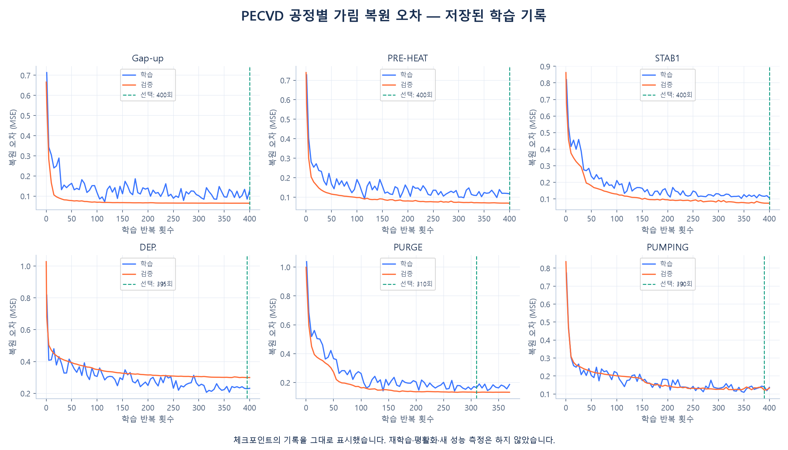
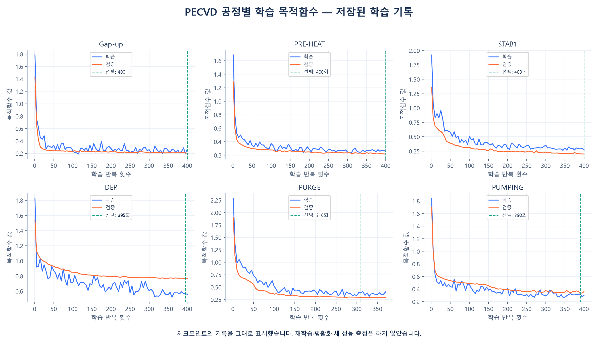
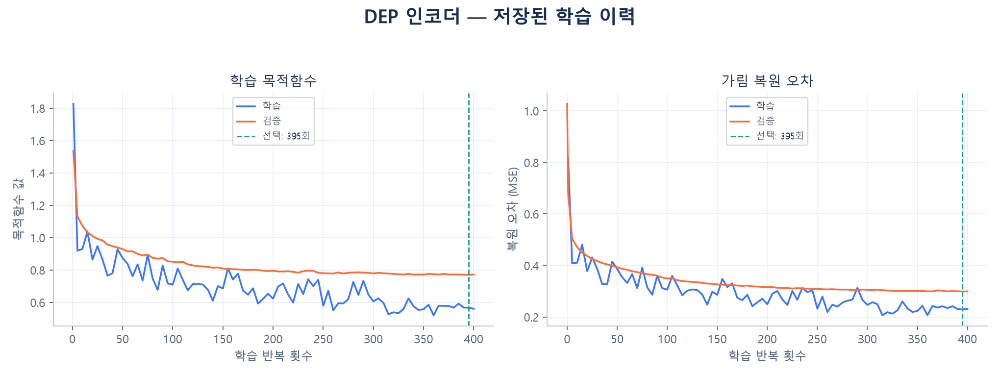

# PECVD 시계열 인코더의 실제 학습 기록

기존 인코더 학습 단계(STEP1)에서 저장한 체크포인트의 학습 이력과 평가 집계입니다. 원본 CSV를
읽거나 모델을 재학습하지 않았습니다. 각 파일의 SHA256을 인코더 목록과 대조한 뒤 생성했습니다.

## 공정별 가림 복원 오차



파란색은 저장된 학습 MSE, 주황색은 검증 가림 복원 MSE입니다. 초록 점선은 마지막 반복이
아닌 실제 저장 가중치 선택 시점을 나타냅니다. 초기 검증값은 0회에 표시하며 기록에 없는 학습값은
만들어 채우지 않습니다. 서로 다른 공정의 센서 분포와 구간 길이가 달라 MSE만으로 난이도를 단정하지 않습니다.

## 선택 시점과 저장된 Test 결과

| 공정 | 원본 시점 수 | 센서 수 | 선택 반복 | 선택 검증 MSE | Test MSE | 영값 기준선 대비 비율 |
|---|---:|---:|---:|---:|---:|---:|
| Gap-up | 40 | 22 | 400 | 0.064539 | 0.046293 | 0.139343 |
| PRE-HEAT | 40 | 22 | 400 | 0.068951 | 0.068568 | 0.163550 |
| STAB1 | 32 | 22 | 400 | 0.074002 | 0.070482 | 0.118546 |
| DEP. | 256 | 22 | 395 | 0.298684 | 0.432190 | 0.482379 |
| PURGE | 56 | 22 | 310 | 0.132321 | 0.102734 | 0.147668 |
| PUMPING | 72 | 22 | 390 | 0.122232 | 0.080540 | 0.175102 |

MSE는 TRAIN 기준 정규화 공간의 제곱 오차입니다. 비율은 저장된 Test 가림 복원 오차를
영값 복원 기준선 오차로 나눈 값이며 작을수록 좋습니다. Test 집계는 저장된 값을 옮긴 것이고
이번 작업에서 다시 평가한 결과가 아닙니다. 집계 표의 원본 표본 수는 이 지표 필드에 포함되어 있지 않습니다.
복원 오차는 ALD 이상 탐지 F1이나 설비 고장 정확도가 아닙니다. DEP의 오차가 높다는 사실만으로
다른 인코더보다 ALD 전이에 적합하다고 결론 내릴 수 없습니다.

## 목적함수와 복원 오차의 구분



목적함수에는 복원 MSE 외에 기울기·센서 관계·변동성·국소 극값·다중 스케일 항이 들어갑니다.
따라서 목적함수와 MSE 곡선은 서로 다른 값입니다. 모델 선택은 저장된 검증 가림 복원 MSE를 따릅니다.

## ALD에 재사용하는 DEP 인코더



저장 가중치 선택 시점은 **395회**, 검증 가림 복원 MSE는 **0.298684**입니다.
ALD에서는 이 인코더와 융합 가중치를 고정하고 별도 판별 헤드를 학습합니다.

## 재생성

```bash
python -m pip install -e ".[docs]"
python scripts/plot_training_history.py --root .
```

현재 제조 체크포인트와 한국어 글꼴이 필요합니다. 배포본에 가중치는 포함되지 않습니다.
그림의 원본 수치와 체크섬은 [학습 기록 JSON](history.json)에 저장했습니다.
